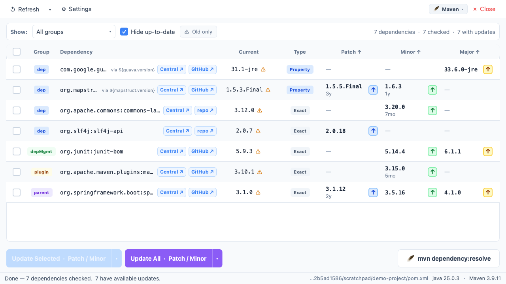

> **This project was fully generated with [Claude Code](https://claude.ai/code).**

# Pom.xml Updater

A desktop app for keeping your Maven dependencies up to date. It works with **Maven, the Maven Wrapper (mvnw), and the Maven Daemon (mvnd)**. Open a `pom.xml`, see available patch / minor / major upgrades fetched live from Maven Central, and apply them in one click — without touching the terminal.



---

## Features

- **Three-column update view** — Patch, Minor, and Major upgrades shown side by side with the release age of each version
- **Version-type badge** — each row shows how the version is defined (Property `${…}`, Exact, Snapshot)
- **Readable names** — each dependency is shown by the `<name>` from its own POM in your local Maven repository (`~/.m2`), no network needed; hover it for the full `groupId:artifactId`. Artifacts that aren't downloaded yet keep showing their coordinates
- **Property-aware updates** — versions managed through `<properties>` entries are resolved and updated at the property definition; every dependency sharing the property follows along
- **Formatting-preserving writes** — updates are applied as exact in-place replacements, so comments, whitespace, and element order in your pom.xml survive untouched
- **Per-dependency update button** — click ↑ on any version to write that single change to disk immediately, no re-fetch required
- **Bulk updates** — select multiple dependencies with checkboxes (including a header _Select All_) and hit _Update Selected_, or use _Update All_ with a configurable scope (Patch only, Patch & Minor only, or all levels including Major)
- **Build-tool aware** — detects the Maven Wrapper (`mvnw`) in the project or a parent directory (multi-module builds), and lets you choose a tool per folder; every command-line action uses the right one
- **Resolve** — run the project's `dependency:resolve` from the toolbar to download the new versions; an in-app overlay streams the live output and reports success or failure
- **Maven Central cache** — fetched version data is cached to disk with a configurable TTL so subsequent opens are instant; cache age is shown in Settings
- **Hard refresh** — bypass the cache entirely and re-fetch all dependency data fresh from Maven Central
- **Version age filter** — hide versions published less than N days ago to avoid freshly released artifacts
- **Old version warning** — a ⚠ badge on the installed version when it has not been updated for longer than a configurable threshold (months or years); filter bar lets you show only flagged dependencies
- **Group filtering** — show only `dependencies`, `dependencyManagement`, `plugins`, or the `parent` POM
- **Hide up-to-date** — collapse rows that have no available upgrade
- **Merge Patch and Minor** — optional display setting that combines the Patch and Minor columns into one
- **Resizable columns** — drag the dividers in the table header to resize columns; widths are remembered between sessions, and the Patch, Minor and Major columns never get narrower than their longest version and its ↑ button
- **Git integration** — current branch shown in the toolbar; a pull button appears when the working copy is behind the remote
- **JDK hint** — the project's `.sdkmanrc` / `.java-version` is shown in the status bar with a warning when it doesn't match the running JDK
- **Recent files** — start screen remembers the last opened projects with last-checked timestamps; scrollable when the list grows long
- **Light & dark theme** — system default, light, or dark; persisted between sessions

---

## Usage

1. Click **Open Folder** or **Open pom.xml** on the start screen (or use `⌘O` / `Ctrl+O`)
2. The app fetches the latest versions for every dependency, managed dependency, plugin, and the parent POM from Maven Central
3. Upgrades appear colour-coded by bump level — **blue** patch, **green** minor, **amber** major
4. Click the **↑** button in any cell to apply that single upgrade immediately
5. Or tick the checkboxes and click **Update Selected** / **Update All**
6. Click **🪶 mvn dependency:resolve** in the action bar to download the written changes without leaving the app

### Settings

Open **⚙ Settings** in the toolbar to configure:

| Panel                   | Options                                                                                  |
|-------------------------|------------------------------------------------------------------------------------------|
| **Theme**               | System default, light, or dark                                                           |
| **Version Age Filter**  | Only show versions published at least N days ago (default: 2)                           |
| **Old Version Warning** | Show ⚠ on dependencies not updated in N months/years (default: 12 months; 0 = disabled) |
| **Version Cache**       | Cache TTL (default: 24 h; 0 = always fetch live) and _Clear Cache Now_                   |
| **Display**             | Merge Patch and Minor columns into one                                                   |
| **Build Tools**         | Default build tool, and per-folder overrides you can remove                             |
| **About**               | App version                                                                              |

---

## Build tools

The app supports **Maven (`mvn`), the Maven Wrapper (`mvnw`), and the Maven
Daemon (`mvnd`)**. All three read the same `pom.xml` and resolve versions from
Maven Central, so only the command-line invocation differs. The active tool is
resolved per project, in this order:

1. A per-folder override you've pinned (via the 🪶 toolbar badge or Settings)
2. A Maven Wrapper script (`mvnw` / `mvnw.cmd`) in the project directory or
   the nearest parent, for multi-module builds
3. Otherwise, the global default (Maven, unless changed in Settings)

The current tool is shown in the toolbar badge and status bar. Click the badge
to change it. Per-folder pins and the global default are managed under
**Settings → Build Tools**.

## What gets updated

The parser reads these pom.xml sections:

| Section                                   | Group shown in the table |
|-------------------------------------------|--------------------------|
| `<dependencies>`                          | `dep`                    |
| `<dependencyManagement>`                  | `depMgmt`                |
| `<build>` / `<reporting>` plugins (incl. `pluginManagement`) | `plugin` |
| `<parent>`                                | `parent`                 |

Versions written as `${some.property}` are resolved against `<properties>`
(following aliases) and updated at the property definition. Entries that
cannot be meaningfully updated are skipped: versions managed by a parent or
imported BOM, version ranges (`[1.0,2.0)`), `LATEST` / `RELEASE`, and internal
references like `${project.version}` or `${revision}`.

---

## Data storage

The app stores two files on disk. Both are created automatically on first run.

| File | Windows | macOS | Linux |
| --- | --- | --- | --- |
| **Settings** (`settings.ini`) | `%APPDATA%\PomXmlUpdater\` | `~/.config/PomXmlUpdater/` | `$XDG_CONFIG_HOME/PomXmlUpdater/` (default `~/.config/PomXmlUpdater/`) |
| **Maven Central cache** (`maven_cache.json`) | `%APPDATA%\PomXmlUpdater\` | `~/Library/Caches/pom-xml-updater/` | `$XDG_CACHE_HOME/pom-xml-updater/` (default `~/.cache/pom-xml-updater/`) |

---

## Requirements

- Python 3.11+
- PyQt6 ≥ 6.11 — the UI is built with **Qt Quick (QML)**; PyQt6 bundles the required Qt Quick / Controls modules
- requests ≥ 2.34

At runtime, a JDK and whichever build tool your projects use must be installed
(`mvn` on PATH, a project `mvnw` script, or `mvnd`). The app also searches
common install locations when resolving them: Homebrew, SDKMAN, jenv, asdf,
mise, and `$JAVA_HOME/bin` (on macOS it falls back to `/usr/libexec/java_home`).

---

## Installation

```bash
# 1. Clone the repository
git clone <repo-url>
cd pom-xml-updater

# 2. Create and activate a virtual environment
python -m venv .venv
source .venv/bin/activate   # Windows: .venv\Scripts\activate

# 3. Install dependencies
pip install -r requirements.txt
```

---

## Running

```bash
python main.py
```

---

## Project structure

The UI is **Qt Quick (QML)**; Python `QObject` controllers expose the
application logic to QML as context properties (`App`, `Project`, `Install`,
`BuildTool`, `Git`). The `core`, `models`, and `workers` layers are pure logic
with no UI coupling.

```
pom-xml-updater/
├── main.py                     # Entry point — boots the QML engine
├── _version.py                 # Version string
├── assets/                     # SVG / PNG icons
├── qml/                        # Qt Quick (QML) user interface
│   ├── Main.qml                # App window: toolbar, page stack, status bar
│   ├── screens/                # Top-level pages
│   │   ├── StartScreen.qml     #   start screen with recent files
│   │   ├── ProjectView.qml     #   filter bar + dependency table + action bar
│   │   └── SettingsPage.qml    #   theme, filters, cache, display, about
│   ├── components/             # Feature-specific widgets
│   │   ├── DependencyTable.qml #   table header + ListView
│   │   ├── DependencyRow.qml   #   per-dependency row delegate
│   │   ├── VersionCell.qml     #   Patch / Minor / Major cell + ↑ button
│   │   ├── ActionBar.qml, RecentFileRow.qml, HeaderLabel.qml
│   │   ├── ThemeCard.qml, MiniPreview.qml   # settings theme previews
│   │   ├── InstallOverlay.qml               # live resolve output overlay
│   │   └── BuildToolDialog.qml              # build-tool picker dialog
│   ├── controls/               # Generic reusable widgets
│   │   ├── AppButton.qml, AppCheckBox.qml, AppComboBox.qml, AppSpinBox.qml
│   │   ├── AppToolButton.qml, AppToolTip.qml, AppMenu.qml, AppMenuItem.qml
│   │   ├── Badge.qml, LinkButton.qml, SplitButton.qml, ThinScrollBar.qml
│   │   └── FlashMessage.qml, ModalDialog.qml
│   └── App/                    # Theme module (import App)
│       ├── qmldir
│       └── Theme.qml           #   singleton light / dark colour palette
├── app/                        # QObject controllers + models bound to QML
│   ├── app_controller.py               # Theme, versions, settings, tool defaults → `App`
│   ├── project_controller.py           # Open/close, fetch, updates, filters      → `Project`
│   ├── dependency_model.py             # QAbstractListModel + filter proxy
│   ├── recent_files_model.py           # Recent-files list model
│   ├── install_controller.py           # Active tool's resolve via QProcess       → `Install`
│   ├── build_tool_controller.py        # Active tool + picker dialog              → `BuildTool`
│   └── git_controller.py               # Branch/behind, fetch/pull, JDK hint      → `Git`
├── core/
│   ├── maven_central.py        # Maven Central search API + scm-link lookup
│   ├── version_cache.py        # Disk-backed registry result cache
│   ├── java_env.py             # Resolves PATH / JAVA_HOME for java + Maven
│   ├── pom_xml.py              # Read / update pom.xml (formatting-preserving)
│   ├── build_tool.py           # Tool detection + per-tool command builders
│   ├── maven_versions.py       # Maven version comparison helpers
│   ├── m2_repo.py              # Local ~/.m2 repository lookups
│   └── git_info.py             # Local git branch / behind-count helpers
├── models/
│   ├── dependency.py           # DependencyInfo dataclass
│   └── settings.py             # Persistent app settings (incl. tool default + overrides)
├── workers/
│   └── fetch_worker.py         # QThread worker for Maven Central fetches
├── tests/                      # unittest suite (pure logic + controllers)
│   ├── test_pom_xml.py                 # pom.xml parse / formatting-preserving save
│   ├── test_maven_versions.py          # version compare / stability / bumps
│   ├── test_build_tool.py              # detection + command builders
│   ├── test_settings_build_tool.py     # settings persistence
│   ├── test_exec_wiring.py             # resolve/version wiring + ~/.m2 checks
│   ├── test_bt_controller.py           # picker + overrides
│   └── test_app_controller_bt.py       # settings-panel API
└── release/
    ├── build.sh / build.bat    # Platform-specific PyInstaller build scripts
    └── pom_xml_updater.spec    # PyInstaller spec
```
